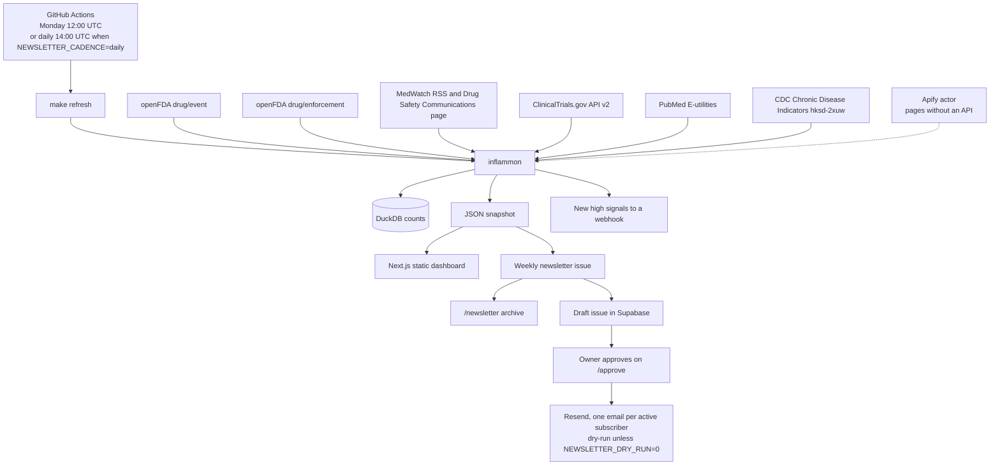

# Open Health Signals

Open Health Signals (https://openhealthsignals.org) is an independent health-data project. Inflammation Signal Monitor is its first project: a public record of FAERS safety signals, FDA notices, recalls, trials, and papers for inflammatory disease.

It watches two problems that are usually split across different websites:

- **Chronic inflammatory disease** — rheumatoid arthritis, Crohn’s disease, ulcerative colitis, psoriasis, and systemic lupus erythematosus.
- **Safety of the drugs used for them** — NSAIDs, corticosteroids, TNF inhibitors (adalimumab, infliximab, etanercept, certolizumab pegol, golimumab), interleukin inhibitors (ustekinumab, secukinumab, ixekizumab, risankizumab, guselkumab, tocilizumab), and JAK inhibitors (tofacitinib, upadacitinib, baricitinib).

Each week the pipeline recounts public FAERS extracts, FDA notices and recalls, ClinicalTrials.gov starts, and PubMed records, scores disproportionality, and republishes a static dashboard. The numbers describe spontaneous reports. They are not incidence rates and they are **not medical advice**.

Maintained by Rakesh Pai.

## Architecture



The Python package normalizes counts into DuckDB, then writes the JSON snapshot the site is built from. The dashboard is a static export. Subscribe, confirm, unsubscribe, contact, and issue approval call Supabase Edge Functions. GitHub Actions is the path that builds and sends. The default schedule is Monday. Set `NEWSLETTER_CADENCE=daily` for a temporary daily test; set it back to `weekly`, or delete it, to return to Monday only. The n8n workflow is an optional example and does not send mail. Spike detection runs on **weekly** counts of publications, trial starts, and dated FDA notices.

## Quickstart

Requires Python 3.11+ and Node 20+.

```bash
make install
make test
make refresh
make dashboard
```

The dashboard runs at <http://127.0.0.1:43123>.

`make refresh` calls the public APIs and rebuilds `data/snapshot/` and `web/data/`. Responses are cached under `data/raw/http/` (gitignored). `make refresh-live` ignores that cache.

A committed snapshot is already in the repository, so the site can be built without calling the APIs:

```bash
cd web && npm install && npm run build
```

`npm run build` writes a static export to `web/out/`.

Weekly cron, from the repository root:

```bash
# Monday 12:00 UTC
0 12 * * 1 /path/to/repo/scripts/weekly_refresh.sh
```

## Dashboard

| Page | What it shows |
| --- | --- |
| Overview | Latest FDA notices and recalls, and whether prespecified known signals are recovered |
| Drug signals | PRR and ROR by class or drug, plus quarterly FAERS counts |
| Disease trends | Publications, trial starts, weekly spike screen, CDC arthritis prevalence |
| Methods | Formulas, sources, licenses, limitations, and the disclaimer |
| About | Purpose, maintainer, and citation |
| Newsletter | Archive of weekly briefings |
| Subscribe | Email signup with consent and double opt-in |
| Confirm | Opens the confirmation link and activates the address |
| Contact | Collaboration, data, code, analysis, media, or sponsorship |
| Approve issue | Owner-only draft preview. Magic link plus an allowlisted email |
| Privacy | Supabase holds the list, Resend sends mail, signed opt-out is immediate |
| Terms | No warranty, no medical advice, no re-identification |
| Unsubscribe | Signed link. POST is RFC 8058 one-click and takes effect immediately |

## Data sources and licenses

| Source | What we use | License |
| --- | --- | --- |
| [openFDA drug/event](https://open.fda.gov/apis/drug/event/) | FAERS counts | CC0 / US government public domain |
| [openFDA drug/enforcement](https://open.fda.gov/apis/drug/enforcement/) | Recalls | CC0 / US government public domain |
| [FDA MedWatch RSS](https://www.fda.gov/about-fda/contact-fda/stay-informed/rss-feeds/medwatch/rss.xml) | Safety notices | US government public domain |
| [Drug Safety Communications](https://www.fda.gov/drugs/drug-safety-and-availability/drug-safety-communications) | HTML index. The RSS path returns 404. | US government public domain |
| [ClinicalTrials.gov API v2](https://clinicaltrials.gov/data-api/api) | Study starts | NLM public-domain terms |
| [PubMed E-utilities](https://www.ncbi.nlm.nih.gov/books/NBK25501/) | Counts and citation metadata. Abstracts are not stored. | NLM terms; abstracts © publishers |
| [CDC Chronic Disease Indicators `hksd-2xuw`](https://data.cdc.gov/resource/hksd-2xuw.json?topic=Arthritis) | Crude arthritis prevalence, US adults, BRFSS | US government public domain |

data.cdc.gov does not publish an IBD surveillance dataset. Crohn’s disease and ulcerative colitis are followed with trial starts and PubMed counts. The latest pull, including any source that failed, is in [`data/snapshot/RUN_REPORT.md`](data/snapshot/RUN_REPORT.md).

openFDA says not to use its API for medical care. Counts are unvalidated and the extract lags the underlying files.

## Methods

For a drug or class and a MedDRA preferred term:

|  | Reaction | No reaction |
| --- | --- | --- |
| Exposed | a | b |
| Comparator | c | d |

- **PRR** = (a / (a+b)) / (c / (c+d))
- **ROR** = (a/b) / (c/d)
- 95% intervals are the normal approximation on the log scale, using 1.96.
- A zero cell adds 0.5 to every cell before the ratios (Haldane–Anscombe). Observed counts are what the table shows.
- **Evans signal:** a ≥ 3, PRR ≥ 2, and χ² ≥ 4.
- **ROR signal:** a ≥ 3 and the lower 95% bound above 1.

Counts are ingredient mentions in the openFDA extract. The API cannot tie `drugcharacterization = 1` to the same drug element, so these are not primary-suspect-only counts. Concomitant mentions dilute signals toward the null.

JAK thrombosis and major cardiovascular events are compared with TNF inhibitors, the active comparator in ORAL Surveillance. A FAERS-wide background is full of hospital-associated thrombosis and can hide that contrast. TNF–tuberculosis and NSAID–gastrointestinal bleeding are compared with the rest of the extract.

The weekly spike rule needs four earlier complete weeks, a z-score of at least 2, and a count at least 1.5 times the baseline mean. The week that contains the refresh day is still open and is excluded.

These statistics do not estimate risk. A higher ratio is a disproportionality signal: the reaction was reported more often than expected (PRR in the table). It is not an incidence rate.

### Known-signal check on the current snapshot

Pulled from the openFDA extract dated 2026-07-30 (20,692,690 reports). Full table: `data/snapshot/RUN_REPORT.md`.

| Check | Result |
| --- | --- |
| JAK vs TNF: pulmonary embolism, deep vein thrombosis, thrombosis | Evans signal. PRR about 2.2–2.5. |
| JAK vs TNF: myocardial infarction, cerebrovascular accident | ROR lower bound above 1. PRR 1.24 and 1.58, so not an Evans signal. Not elevated against all of FAERS. |
| TNF inhibitors: tuberculosis and pulmonary tuberculosis | Evans signal. PRR about 6.9–7.5. |
| NSAIDs: gastrointestinal haemorrhage, gastric ulcer, melaena | Evans signal. PRR about 2.5, 6.3, and 4.2. |

## Deploy to Vercel, and a custom domain

The dashboard is a Next.js app with `output: "export"`.

[](https://vercel.com/new/clone?repository-url=https%3A%2F%2Fgithub.com%2FYOUR_GITHUB_OWNER%2Finflammation-signal-monitor&project-name=inflammation-signal-monitor&root-directory=web&env=NEXT_PUBLIC_SUPABASE_URL,NEXT_PUBLIC_SUPABASE_ANON_KEY,NEXT_PUBLIC_FUNCTIONS_BASE,NEXT_PUBLIC_TURNSTILE_SITE_KEY,NEXT_PUBLIC_SITE_URL&envDescription=Public%20site%20values%20baked%20into%20the%20static%20build.%20Put%20service%20role%20and%20Resend%20keys%20in%20GitHub%20and%20Supabase%2C%20not%20here.)

Replace `YOUR_GITHUB_OWNER` after the repository is on GitHub. Set **Root Directory** to `web` if the button does not. Framework preset: Next.js. Build command: `npm run build`. Vercel serves the static `out` directory produced by `output: "export"`.

The dashboard itself builds with no secrets. Subscribe, confirm, contact, and approve need the public variables in the button **before** the build. They are baked into the static pages.

Custom domain:

1. Open the Vercel project → **Settings** → **Domains** → add the domain.
2. At the DNS host, use the records Vercel shows. For a subdomain that is typically a `CNAME` to `cname.vercel-dns.com`. For an apex domain, Vercel shows an `A` record (currently `76.76.21.21`) or their nameservers.
3. Wait until Vercel reports the domain as valid. The certificate is issued automatically.

Any static host can serve `web/out/` the same way. GitHub Actions (`.github/workflows/weekly-refresh.yml`) reruns the pull on the newsletter cadence (Monday 12:00 UTC, or every day at 14:00 UTC while `NEWSLETTER_CADENCE=daily`) and commits the new snapshot; redeploy after that commit if the host does not rebuild on push.

The live site is [openhealthsignals.org](https://openhealthsignals.org), a Cloudflare Pages deploy of the static export in `web/out`. Run `make dashboard` to work locally. A live newsletter send is refused until `NEWSLETTER_POSTAL_ADDRESS` is a real postal address.

## Automation

| Piece | Schedule |
| --- | --- |
| `scripts/weekly_refresh.sh` and `make refresh` | Weekly. Example crontab: Monday 12:00 UTC. |
| `.github/workflows/weekly-refresh.yml` | `0 12 * * 1` when `NEWSLETTER_CADENCE` is `weekly` or unset. `0 14 * * *` when it is `daily`. The job builds a draft. The owner approves it on `/approve`, which dispatches the send job. `NEWSLETTER_AUTO_SEND=1` skips the wait. Dry-run stays on unless `NEWSLETTER_DRY_RUN` is `0`. |
| `n8n/ism-weekly-refresh.json` | Optional example, not the path that sends. Self-hosted only. See `n8n/README.md`. |
| `apify/fda-safety-pages/` | Actor stub for the Drug Safety Communications page and state health-department pages that have no API. |

## Weekly newsletter

`make newsletter` (or `python -m inflammon newsletter`) diffs the current snapshot against the previous fingerprint and writes:

- `data/newsletter/issues/<date>/` — `issue.json`, `issue.html`, and `issue.txt`
- `data/newsletter/index.json` and `data/newsletter/state/` — the archive index and the fingerprint used next week
- `web/data/newsletter/` — the same issue, read by the static site
- `web/public/newsletter/email/<date>.html` — the email, served at `/newsletter/email/<date>.html`

The scheduled GitHub Action stores that issue as a **draft** in the `issues` table. The owner signs in at `/approve` with a Supabase magic link. Row level security shows the draft only when that email is in `owner_allowlist`. Approving the draft calls `dispatch-send`, which starts the send job. `NEWSLETTER_AUTO_SEND=1` sends on that run without that wait.

The send is still a **dry run** unless `NEWSLETTER_DRY_RUN` is exactly `0`. A dry run writes the archive and does not call Resend. Rebuilding the same snapshot does not treat it as new; the diff uses the fingerprint from the prior snapshot.

Subscribe, confirm, and contact send their own short messages through the same Resend key (`RESEND_API_KEY`, `NEWSLETTER_FROM`). A new address gets a confirmation link. Asking again while it is still pending sends a fresh link, up to three confirmation emails an hour for that address. Opening the link sends a welcome note: what the weekly digest covers, that it is informational and not medical advice, and a one-click unsubscribe link. A contact request stores the row, then emails an acknowledgement to the sender and the full message to `OWNER_NOTIFY_EMAIL` (default `rakeshpai@openhealthsignals.org`). The reply-to on the acknowledgement is `contact@openhealthsignals.org`. The owner copy replies to the sender. If those sends fail, the request still succeeds. Anything other than `NEWSLETTER_DRY_RUN` set to exactly `0` logs a masked recipient and does not call Resend. The postal line is included only when `NEWSLETTER_POSTAL_ADDRESS` is set.

### Temporary daily testing

`NEWSLETTER_CADENCE` is `weekly` when the variable is missing. Set the GitHub Actions variable to exactly `daily` to test more often:

- The same workflow also runs every day at **14:00 UTC**. The Monday 12:00 UTC cron skips while the variable is `daily`, so the two schedules do not both publish.
- The issue is still the diff against the previous fingerprint. A thin diff is still archived and still eligible to send. The kicker and subject say **Daily test edition**. Empty sections say “None in this daily edition.”
- Approval, suppression, and dry-run are unchanged. Leave `NEWSLETTER_AUTO_SEND` empty so the draft waits on `/approve`. Leave `NEWSLETTER_DRY_RUN` empty or `1` so Resend is not called. A manual `workflow_dispatch` and an `issue-approved` dispatch still run, on either cadence.

Switch back to weekly:

1. GitHub → Settings → Secrets and variables → Actions → Variables.
2. Set `NEWSLETTER_CADENCE` to `weekly`, or delete the variable.
3. The next newsletter run is Monday at 12:00 UTC. The 14:00 UTC cron stays in the workflow and skips.

Locally, `NEWSLETTER_CADENCE=daily python -m inflammon newsletter` writes a daily test edition. Unset the variable, or set it to `weekly`, before the next normal build so the archive label returns to the weekly issue.

Each real send re-reads the subscriber row, skips anything that is not `active` (pending, unsubscribed, bounced, complained), and posts one Resend email per remaining address. The request carries an `Idempotency-Key` of `issue:subscriber`, and `List-Unsubscribe` plus `List-Unsubscribe-Post: List-Unsubscribe=One-Click`. The result is logged in `sends`.

The first issue has no earlier snapshot, so it lists the latest notices and the strongest prespecified signals. Later issues list what changed: new alerts and recalls, signals that newly meet the Evans or ROR screen, signals whose PRR rose by at least 25%, and trials and papers that were not in the previous extract.

Headlines name the reports and say what the FAERS signal does and does not show. The preheader and the first screen carry one line: a reporting signal is not proof a drug caused an event. Each issue includes the openFDA caveat, the research-only line, the FDA attribution, the extract date, and a signed unsubscribe link. The postal line is printed only when `NEWSLETTER_POSTAL_ADDRESS` is set. PubMed entries are titles and links, plus the NCBI disclaimer.

### Accounts, and which key goes where

You need four accounts. Copy [`.env.example`](.env.example).

| Account | What to create | Where the value goes |
| --- | --- | --- |
| Supabase | Project, then `supabase db push` (or run `supabase/migrations` and `supabase/seed.sql` in the SQL editor). Add the owner email to `owner_allowlist`. Deploy `supabase/functions/*`. | `NEXT_PUBLIC_SUPABASE_URL` and `NEXT_PUBLIC_SUPABASE_ANON_KEY` on Vercel, before the build. `SUPABASE_URL` and `SUPABASE_SERVICE_ROLE_KEY` as GitHub secrets **and** as function secrets. `SUPABASE_ANON_KEY` as a function secret for `dispatch-send`. |
| Resend | A verified domain and a webhook pointing at `https://<project-ref>.supabase.co/functions/v1/resend-webhook` for `email.bounced` and `email.complained`. | `RESEND_API_KEY` as a GitHub secret and a function secret. `NEWSLETTER_FROM` as a GitHub variable and a function secret. `RESEND_WEBHOOK_SECRET` (`whsec_…`) as a function secret only. |
| Cloudflare Turnstile | A widget on the dashboard hostname. The test site key `1x00000000000000000000AA` and secret `1x0000000000000000000000000000000AA` always pass and are safe for a local dry run. | `NEXT_PUBLIC_TURNSTILE_SITE_KEY` on Vercel. `TURNSTILE_SECRET_KEY` as a function secret. |
| GitHub | Repository variables and secrets for the Monday workflow. A fine-grained token that can dispatch workflows, stored only as a function secret. | Listed below. |

GitHub **secrets** (Settings → Secrets and variables → Actions → Secrets):

- `OPENFDA_API_KEY`
- `SUPABASE_URL`
- `SUPABASE_SERVICE_ROLE_KEY`
- `RESEND_API_KEY`
- `UNSUBSCRIBE_HMAC_SECRET`

GitHub **variables**:

- `NCBI_EMAIL`, `SITE_URL`, `FUNCTIONS_BASE`, `NEWSLETTER_FROM`, `NEWSLETTER_POSTAL_ADDRESS`
- `NEWSLETTER_CADENCE` — `weekly` or empty for Monday 12:00 UTC. `daily` for a temporary test at 14:00 UTC every day. Set it back to `weekly`, or delete it, to leave daily testing.
- `NEWSLETTER_AUTO_SEND` — `1` to send without approval, otherwise empty
- `NEWSLETTER_DRY_RUN` — leave empty or `1` until a real send; set to `0` to allow Resend

Function secrets (Supabase → Edge Functions → Secrets), same names: `SUPABASE_URL`, `SUPABASE_SERVICE_ROLE_KEY`, `SUPABASE_ANON_KEY`, `RESEND_API_KEY`, `NEWSLETTER_FROM`, `UNSUBSCRIBE_HMAC_SECRET`, `RESEND_WEBHOOK_SECRET`, `TURNSTILE_SECRET_KEY`, `OWNER_NOTIFY_EMAIL`, `SITE_URL`, `NEWSLETTER_DRY_RUN`, `GITHUB_DISPATCH_TOKEN`, `GITHUB_REPOSITORY`.

Vercel, public, set before the build: `NEXT_PUBLIC_SUPABASE_URL`, `NEXT_PUBLIC_SUPABASE_ANON_KEY`, `NEXT_PUBLIC_FUNCTIONS_BASE`, `NEXT_PUBLIC_TURNSTILE_SITE_KEY`, `NEXT_PUBLIC_SITE_URL`.

Local dry run, in `web/.env.local` (gitignored):

```bash
NEXT_PUBLIC_FUNCTIONS_BASE=http://127.0.0.1:43124
NEXT_PUBLIC_TURNSTILE_SITE_KEY=1x00000000000000000000AA
NEXT_PUBLIC_LOCAL_PREVIEW=1
NEXT_PUBLIC_SITE_URL=http://127.0.0.1:43123
```

Then `python -m inflammon.local_functions` and `make dashboard`. No Resend call is made. The confirmation link is shown on the page, and the message that would have been sent is logged.

Studio, not a custom admin panel: open the SQL editor and select `subscriber_search`, `subscriber_export`, or `suppression_list`. Contact notes and status live on `contact_requests`.

The case-level FAERS warehouse is not built. The design is in [`docs/warehouse.md`](docs/warehouse.md).

## Tests

```bash
make test
```

The tests check PRR, ROR, confidence intervals, chi-square, the Evans rule, the Haldane correction, and the weekly spike rule against hand-computed 2×2 tables. Newsletter tests check the snapshot diff, HTML escaping, the plain-text rendering, and that a dry run does not call the network. List tests check HMAC unsubscribe tokens, suppression re-read at send time, and Svix webhook verification against a fixture. `tests/mailing.test.mjs` checks that the edge-function helpers produce the same token, signature, and transactional copy.

## Citation

See [`CITATION.cff`](CITATION.cff).

> Pai R. Open Health Signals: Inflammation Signal Monitor. Public FAERS dashboard for inflammatory disease and anti-inflammatory drug safety. 2026. https://openhealthsignals.org

## License

Code: [MIT](LICENSE). Data files keep the licenses in the table above.

## Contributing

See [CONTRIBUTING.md](CONTRIBUTING.md).
