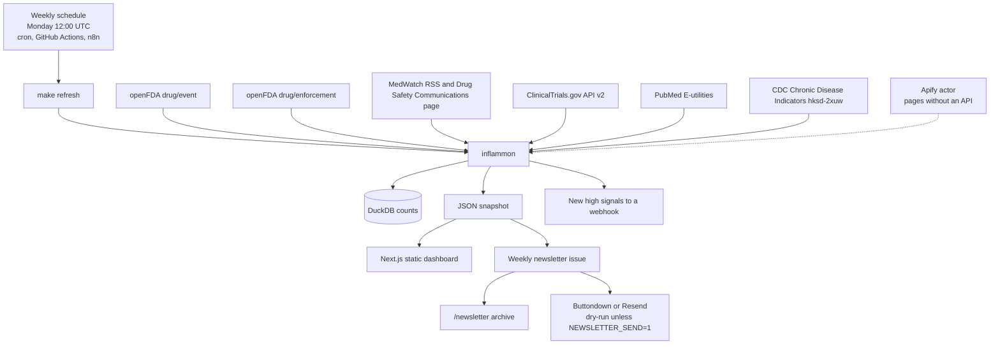

# Inflammation Signal Monitor

A free, open-source public-health monitor for immune-mediated inflammatory disease and the drugs used to treat it.

It watches two problems that are usually split across different websites:

- **Chronic inflammatory disease** — rheumatoid arthritis, Crohn’s disease, ulcerative colitis, psoriasis, and systemic lupus erythematosus.
- **Safety of the drugs used for them** — NSAIDs, corticosteroids, TNF inhibitors (adalimumab, infliximab, etanercept, certolizumab pegol, golimumab), interleukin inhibitors (ustekinumab, secukinumab, ixekizumab, risankizumab, guselkumab, tocilizumab), and JAK inhibitors (tofacitinib, upadacitinib, baricitinib).

Each week the pipeline recounts public FAERS extracts, FDA notices and recalls, ClinicalTrials.gov starts, and PubMed records, scores disproportionality, and republishes a static dashboard. The numbers describe spontaneous reports. They are not incidence rates and they are **not medical advice**.

Maintained by Rakesh Pai.

## Architecture



The Python package normalizes counts into DuckDB, then writes the JSON snapshot the site is built from. The site has no backend. Spike detection runs on **weekly** counts of publications, trial starts, and dated FDA notices. The refresh itself is weekly, not daily.

## Quickstart

Requires Python 3.11+ and Node 20+.

```bash
make install
make test
make refresh
make dashboard
```

The dashboard runs at <http://127.0.0.1:43123>.

`make refresh` calls the public APIs and rebuilds `data/snapshot/` and `web/data/`. Responses are cached under `data/raw/http/` (gitignored). `make refresh-live` ignores that cache.

A committed snapshot is already in the repository, so the site can be built without calling the APIs:

```bash
cd web && npm install && npm run build
```

`npm run build` writes a static export to `web/out/`.

Weekly cron, from the repository root:

```bash
# Monday 12:00 UTC
0 12 * * 1 /path/to/repo/scripts/weekly_refresh.sh
```

## Dashboard

| Page | What it shows |
| --- | --- |
| Overview | Latest FDA notices and recalls, and whether prespecified known signals are recovered |
| Drug signals | PRR and ROR by class or drug, plus quarterly FAERS counts |
| Disease trends | Publications, trial starts, weekly spike screen, CDC arthritis prevalence |
| Methods | Formulas, sources, licenses, limitations, and the disclaimer |
| About | Purpose, maintainer, and citation |
| Newsletter | Archive of weekly briefings |
| Subscribe | Email signup with consent and double opt-in |

## Data sources and licenses

| Source | What we use | License |
| --- | --- | --- |
| [openFDA drug/event](https://open.fda.gov/apis/drug/event/) | FAERS counts | CC0 / US government public domain |
| [openFDA drug/enforcement](https://open.fda.gov/apis/drug/enforcement/) | Recalls | CC0 / US government public domain |
| [FDA MedWatch RSS](https://www.fda.gov/about-fda/contact-fda/stay-informed/rss-feeds/medwatch/rss.xml) | Safety notices | US government public domain |
| [Drug Safety Communications](https://www.fda.gov/drugs/drug-safety-and-availability/drug-safety-communications) | HTML index. The RSS path returns 404. | US government public domain |
| [ClinicalTrials.gov API v2](https://clinicaltrials.gov/data-api/api) | Study starts | NLM public-domain terms |
| [PubMed E-utilities](https://www.ncbi.nlm.nih.gov/books/NBK25501/) | Counts and citation metadata. Abstracts are not stored. | NLM terms; abstracts © publishers |
| [CDC Chronic Disease Indicators `hksd-2xuw`](https://data.cdc.gov/resource/hksd-2xuw.json?topic=Arthritis) | Crude arthritis prevalence, US adults, BRFSS | US government public domain |

data.cdc.gov does not publish an IBD surveillance dataset. Crohn’s disease and ulcerative colitis are followed with trial starts and PubMed counts. The latest pull, including any source that failed, is in [`data/snapshot/RUN_REPORT.md`](data/snapshot/RUN_REPORT.md).

openFDA says not to use its API for medical care. Counts are unvalidated and the extract lags the underlying files.

## Methods

For a drug or class and a MedDRA preferred term:

|  | Reaction | No reaction |
| --- | --- | --- |
| Exposed | a | b |
| Comparator | c | d |

- **PRR** = (a / (a+b)) / (c / (c+d))
- **ROR** = (a/b) / (c/d)
- 95% intervals are the normal approximation on the log scale, using 1.96.
- A zero cell adds 0.5 to every cell before the ratios (Haldane–Anscombe). Observed counts are what the table shows.
- **Evans signal:** a ≥ 3, PRR ≥ 2, and χ² ≥ 4.
- **ROR signal:** a ≥ 3 and the lower 95% bound above 1.

Counts are ingredient mentions in the openFDA extract. The API cannot tie `drugcharacterization = 1` to the same drug element, so these are not primary-suspect-only counts. Concomitant mentions dilute signals toward the null.

JAK thrombosis and major cardiovascular events are compared with TNF inhibitors, the active comparator in ORAL Surveillance. A FAERS-wide background is full of hospital-associated thrombosis and can hide that contrast. TNF–tuberculosis and NSAID–gastrointestinal bleeding are compared with the rest of the extract.

The weekly spike rule needs four earlier complete weeks, a z-score of at least 2, and a count at least 1.5 times the baseline mean. The week that contains the refresh day is still open and is excluded.

These statistics do not estimate risk and do not show that a drug caused an event.

### Known-signal check on the current snapshot

Pulled from the openFDA extract dated 2026-07-30 (20,692,690 reports). Full table: `data/snapshot/RUN_REPORT.md`.

| Check | Result |
| --- | --- |
| JAK vs TNF: pulmonary embolism, deep vein thrombosis, thrombosis | Evans signal. PRR about 2.2–2.5. |
| JAK vs TNF: myocardial infarction, cerebrovascular accident | ROR lower bound above 1. PRR 1.24 and 1.58, so not an Evans signal. Not elevated against all of FAERS. |
| TNF inhibitors: tuberculosis and pulmonary tuberculosis | Evans signal. PRR about 6.9–7.5. |
| NSAIDs: gastrointestinal haemorrhage, gastric ulcer, melaena | Evans signal. PRR about 2.5, 6.3, and 4.2. |

## Deploy to Vercel, and a custom domain

The dashboard is a Next.js app with `output: "export"`.

1. Push this repository to GitHub.
2. In Vercel, import the repository and set **Root Directory** to `web`.
3. Framework preset: Next.js. Build command: `npm run build`. Vercel serves the static `out` directory produced by `output: "export"`.
4. The dashboard itself builds with no secrets. To connect the subscribe form, set the public variables below **before** the build. They are baked into the static pages.

Custom domain:

1. Open the Vercel project → **Settings** → **Domains** → add the domain.
2. At the DNS host, use the records Vercel shows. For a subdomain that is typically a `CNAME` to `cname.vercel-dns.com`. For an apex domain, Vercel shows an `A` record (currently `76.76.21.21`) or their nameservers.
3. Wait until Vercel reports the domain as valid. The certificate is issued automatically.

Any static host can serve `web/out/` the same way. GitHub Actions (`.github/workflows/weekly-refresh.yml`) reruns the pull every Monday at 12:00 UTC and commits the new snapshot; redeploy after that commit if the host does not rebuild on push.

There is no public preview URL from this workspace. Run `make dashboard` locally, or deploy with the steps above.

## Automation

| Piece | Schedule |
| --- | --- |
| `scripts/weekly_refresh.sh` and `make refresh` | Weekly. Example crontab: Monday 12:00 UTC. |
| `.github/workflows/weekly-refresh.yml` | `0 12 * * 1` |
| `n8n/ism-weekly-refresh.json` | Monday 12:00 UTC. After `make refresh`, one branch posts **new** high signals to `SIGNAL_WEBHOOK_URL` and another runs `make newsletter`. The newsletter runs even when there are no new high signals. The first snapshot is a baseline and does not call the webhook. Self-hosted n8n only. See `n8n/README.md`. |
| `apify/fda-safety-pages/` | Actor stub for the Drug Safety Communications page and state health-department pages that have no API. |

## Weekly newsletter

`make newsletter` (or `python -m inflammon newsletter`) diffs the current snapshot against the previous fingerprint and writes:

- `data/newsletter/issues/<date>/` — `issue.json`, `issue.html`, and `issue.txt`
- `data/newsletter/index.json` and `data/newsletter/state/` — the archive index and the fingerprint used next week
- `web/data/newsletter/` — the same issue, read by the static site
- `web/public/newsletter/email/<date>.html` — the email, served at `/newsletter/email/<date>.html`

The default is a **dry run**: the issue is archived and nothing is emailed. Sending happens only with `--send` or `NEWSLETTER_SEND=1`. `NEWSLETTER_DRY_RUN=1` forces a dry run even then. Rebuilding the same snapshot does not treat it as new; the diff uses the fingerprint from the prior snapshot.

The first issue has no earlier snapshot, so it lists the latest notices and the strongest prespecified signals. Later issues list what changed: new alerts and recalls, signals that newly meet the Evans or ROR screen, signals whose PRR rose by at least 25%, and trials and papers that were not in the previous extract.

### Which key goes where

Copy [`.env.example`](.env.example). The static site and the Monday job do not read the same variables.

| Variable | Who reads it | Secret? |
| --- | --- | --- |
| `NEXT_PUBLIC_NEWSLETTER_PROVIDER` | Next.js build (`web/.env.local` or the Vercel project). `buttondown` or `resend`. | No. It is visible in the static pages. |
| `NEXT_PUBLIC_BUTTONDOWN_USERNAME` | Next.js build. Buttondown username for the embed form. | No. |
| `NEXT_PUBLIC_SUBSCRIBE_ENDPOINT` | Next.js build, only for the Resend alternative. URL of the separate subscribe function. | No. |
| `BUTTONDOWN_API_KEY` | Monday job (`python -m inflammon newsletter`) and GitHub Actions secret `BUTTONDOWN_API_KEY`. | Yes. Never `NEXT_PUBLIC_`. |
| `NEWSLETTER_PROVIDER` | Monday job. `buttondown` (default) or `resend`. | No. |
| `SITE_URL` | Monday job. Absolute dashboard URL printed in the email. GitHub variable `SITE_URL`. | No. |
| `NEWSLETTER_SEND` | Monday job. `1` sends. Empty or anything else is a dry run. GitHub variable `NEWSLETTER_SEND`. A manual workflow run sends only if **send_newsletter** is checked. | No. |
| `RESEND_API_KEY` | Monday job and the Resend function. GitHub secret `RESEND_API_KEY`. | Yes. |
| `RESEND_AUDIENCE_ID` | Monday job and the Resend function. GitHub secret `RESEND_AUDIENCE_ID`. | Treat as a secret. |
| `NEWSLETTER_FROM` | Monday job and the Resend function. Verified sender. GitHub variable `NEWSLETTER_FROM`. | No. |
| `NEWSLETTER_CONFIRM_SECRET` | Resend function only. Signs the confirmation link. | Yes. |
| `SUBSCRIBE_FUNCTION_URL` | Resend function only. Public origin of that deploy. | No. |

Buttondown is the path that works on a static export. The form is a normal HTML POST to `https://buttondown.com/api/emails/embed-subscribe/<username>` with `email` and `embed=1`. Buttondown does not activate the address until the person opens the confirmation email. The consent checkbox is `required`, so the browser blocks submit until it is checked. If the username is missing, the form stays on the page and says the list is not connected.

The Monday send is `POST https://api.buttondown.com/v1/emails` with `Authorization: Token <BUTTONDOWN_API_KEY>`, status `about_to_send`, and the HTML prefixed by `<!-- buttondown-editor-mode: fancy -->`. The unsubscribe link is Buttondown’s `{{ unsubscribe_url }}`.

Resend cannot collect subscribers from a static page by itself. `newsletter/resend/` is a separate two-route function: `POST /subscribe` emails a confirmation link, and `GET /confirm` adds the address to the audience. Deploy that directory on its own (see `newsletter/resend/README.md`). The Monday job then creates a broadcast and calls `/broadcasts/{id}/send`. The unsubscribe token is `{{{RESEND_UNSUBSCRIBE_URL}}}`.

Create `web/.env.local` for local dashboard builds (that file is gitignored):

```bash
NEXT_PUBLIC_NEWSLETTER_PROVIDER=buttondown
NEXT_PUBLIC_BUTTONDOWN_USERNAME=your-buttondown-username
```

Leave the API key out of that file. Export `BUTTONDOWN_API_KEY` only in the shell or the GitHub secret that runs `make newsletter`.

## Tests

```bash
make test
```

The tests check PRR, ROR, confidence intervals, chi-square, the Evans rule, the Haldane correction, and the weekly spike rule against hand-computed 2×2 tables. Newsletter tests check the snapshot diff, HTML escaping, the plain-text rendering, and that a dry run does not call the network.

## Citation

See [`CITATION.cff`](CITATION.cff).

> Pai R. Inflammation Signal Monitor (version 0.1.0). Open-source pharmacovigilance dashboard for inflammatory disease and anti-inflammatory drug safety. 2026.

## License

Code: [MIT](LICENSE). Data files keep the licenses in the table above.

## Contributing

See [CONTRIBUTING.md](CONTRIBUTING.md).
